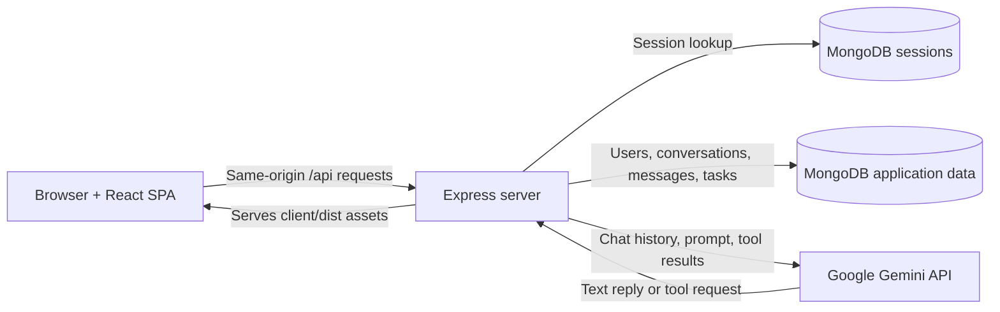

# AI Personal Assistant

An AI-powered personal assistant for persistent conversations and task management. Users register or log in with an email and password, then chat with Google Gemini. Gemini can call backend tools to create, retrieve, update, and delete that user's tasks. Conversations, messages, users, tasks, and login sessions are stored in MongoDB.

## Live Demo

**Live Application:** [AI Personal Assistant](https://ai-personal-assistant-api.onrender.com)

## Features

- AI-powered conversational assistant using Google Gemini.
- User registration and login with bcrypt password hashing.
- HTTP-only cookie authentication backed by MongoDB sessions.
- Persistent, user-scoped conversation history.
- Task creation, retrieval, updates, and deletion through chat.
- Gemini function/tool calling with backend argument validation and execution.
- MongoDB persistence through Mongoose.

## Technology stack

- **Frontend:** React and Vite
- **Backend:** Node.js and Express
- **Database:** MongoDB and Mongoose
- **AI:** Google Gemini API through `@google/genai`
- **Authentication:** `bcryptjs`, `express-session`, and `connect-mongo`

## Architecture

In production, Express serves the built React client and the API from the same origin. The browser calls `/api` with its session cookie, and the API stores sessions in MongoDB. During local development, Vite proxies `/api` requests to the Express server. Protected conversation and chat handlers use the authenticated user's ID to scope database access. For chat requests, the backend loads the owned conversation's history, sends it and the user's message to Gemini, executes any validated tool calls against that user's tasks, returns tool results to Gemini, and stores the completed message exchange in MongoDB.



Gemini does not access MongoDB directly. It can request only the tools declared by the backend; the backend validates their arguments and supplies the authenticated user's ID when executing task operations.

## Project structure

```text
.
|-- client/
|   |-- src/
|   |   |-- App.jsx                 # Authentication and chat interface
|   |   |-- main.jsx                # React entry point
|   |   `-- style.css               # Application styles
|   |-- index.html
|   |-- package-lock.json
|   |-- package.json
|   `-- vite.config.js
|-- config/
|   `-- gemini.js                   # Gemini client and model configuration
|-- middleware/
|   `-- requireAuth.js              # Session authentication middleware
|-- models/
|   |-- Conversation.js
|   |-- Message.js
|   |-- Task.js
|   `-- User.js
|-- routes/
|   |-- authRoutes.js
|   |-- chatRoutes.js
|   `-- conversationRoutes.js
|-- services/
|   |-- chatService.js              # Gemini requests and tool orchestration
|   |-- conversationService.js      # Conversation and history queries
|   |-- dateResolutionService.js
|   |-- taskService.js              # User-scoped task operations
|   `-- toolService.js              # Gemini tool definitions and handlers
|-- tests/
|   |-- authRoutes.test.js
|   |-- chatService.test.js
|   |-- conversationService.test.js
|   |-- dateResolution.test.js
|   |-- deleteTask.test.js
|   |-- taskService.test.js
|   `-- updateTask.test.js
|-- chatExperiment.js               # Manual Gemini experiment
|-- db.js                           # MongoDB connection
|-- package-lock.json
|-- package.json
|-- server.js                       # Express app and middleware setup
|-- testChatService.js              # Manual chat service utility
|-- testConversationService.js      # Manual history utility
|-- testCRUD.js                     # Manual MongoDB CRUD utility
|-- testDB.js                       # Manual database connection utility
`-- .env.example
```

The root-level `test*.js` scripts and `chatExperiment.js` are manual database/Gemini utilities; they are not part of the automated test command.

## Authentication workflow

1. **Registration:** The client submits a name, email, and password to `POST /api/auth/register`. The backend trims and lowercases the email, validates the input, hashes the password with bcrypt, and stores the hash with the user record.
2. **Login:** The client submits an email and password to `POST /api/auth/login`. The backend retrieves the password hash, compares it with bcrypt, regenerates the session to prevent session fixation, and stores the user ID in the new session.
3. **Session cookie:** Express sends the session identifier in the `assistant.sid` cookie. It is HTTP-only, uses `SameSite=Lax`, and is marked `Secure` in production. Session data is stored in MongoDB's `sessions` collection and expires after seven days.
4. **Protected requests:** The browser sends the cookie with API requests. `requireAuth` resolves the session's user and attaches that user to the request. Conversation and chat handlers use that identity rather than accepting a user ID from the client.
5. **Logout:** `POST /api/auth/logout` destroys the server-side session and clears the cookie.

Legacy records owned by the former demo user are left in MongoDB and are not automatically assigned to new accounts.

## Gemini tool-calling workflow

The chat service loads chronological history for the conversation after checking that the authenticated user owns it. It sends that history and the new user message to Gemini along with the available function declarations. Depending on the request, the backend may restrict which tool Gemini can call.

When Gemini requests a tool, the backend checks the tool name and arguments, then calls the corresponding task service function. The task service scopes reads, updates, and deletes by the authenticated user's ID. The backend sends the tool result back to Gemini, which can produce a final response. The user's message and final model response are saved to MongoDB, and the parent conversation's `updatedAt` is advanced.

Available tools are `createTask`, `getTasks`, `updateTask`, and `deleteTask`. Task operations are currently available through chat; there is no separate `/api/tasks` endpoint.

| Tool | Arguments supplied to Gemini |
| --- | --- |
| `createTask` | `title`; optional `dateExpression` when the user gives a due date |
| `getTasks` | `status`: `all`, `pending`, or `completed` |
| `updateTask` | `taskId`; optional `title`, `dateExpression`, and/or `status` |
| `deleteTask` | `taskId` |

## API reference

All endpoints are mounted under `/api`. Except for registration, login, and logout, the endpoints below require a valid session cookie. JSON request bodies use `Content-Type: application/json`.

### Authentication

#### `POST /api/auth/register`

Request:

```json
{
  "name": "Avery Example",
  "email": "avery@example.com",
  "password": "at-least-8-characters"
}
```

Success (`201`):

```json
{
  "user": {
    "id": "USER_OBJECT_ID",
    "name": "Avery Example",
    "email": "avery@example.com"
  }
}
```

The response also sets the HTTP-only session cookie. Invalid input returns `400`; an email already in use returns `409`.

#### `POST /api/auth/login`

Request:

```json
{
  "email": "avery@example.com",
  "password": "your-password"
}
```

Success (`200`) returns the same public `user` shape as registration and sets a regenerated session cookie. Invalid fields return `400`; incorrect credentials return `401`.

#### `POST /api/auth/logout`

No request body is required. Success (`200`):

```json
{ "message": "Logged out." }
```

The route destroys the current session when present and clears the cookie.

#### `GET /api/auth/me`

Returns the logged-in user's public profile (`200`):

```json
{
  "user": {
    "id": "USER_OBJECT_ID",
    "name": "Avery Example",
    "email": "avery@example.com"
  }
}
```

An absent or invalid session returns `401`. Password hashes and session IDs are not included in JSON responses.

### Conversations

#### `GET /api/conversations`

Returns the authenticated user's conversations, newest activity first (`200`):

```json
{
  "conversations": [
    { "conversationId": "CONVERSATION_OBJECT_ID", "title": "New Conversation" }
  ]
}
```

#### `POST /api/conversations`

Creates a conversation for the authenticated user. No request body is required. Success (`201`):

```json
{ "conversationId": "CONVERSATION_OBJECT_ID" }
```

#### `GET /api/conversations/:conversationId/messages`

Returns messages in chronological order (`200`):

```json
{
  "messages": [
    { "role": "user", "content": "Hello", "createdAt": "2026-01-01T12:00:00.000Z" },
    { "role": "model", "content": "Hi!", "createdAt": "2026-01-01T12:00:01.000Z" }
  ]
}
```

An invalid conversation ID returns `400`; a missing conversation or one not owned by the user returns `404`.

### Chat

#### `POST /api/chat`

Sends a message to an owned conversation and returns Gemini's final response.

Request:

```json
{
  "conversationId": "CONVERSATION_OBJECT_ID",
  "message": "Remind me to submit the report tomorrow"
}
```

Success (`200`):

```json
{ "reply": "I created a task to submit the report for tomorrow." }
```

Missing or invalid fields return `400`; an unowned or missing conversation returns `404`; processing failures return `500`.

## Installation and local setup

### Prerequisites

- Node.js and npm
- A MongoDB database (local or hosted)
- A Google Gemini API key

### Configure the backend

From the project root:

```bash
npm install
```

Copy the root `.env.example` to `.env` and set the backend values described below. `SESSION_SECRET` must be set or the server will not start. For the frontend, copy `client/.env.example` to `client/.env`; its `VITE_API_URL=/api` value works with the local Vite proxy and the same-origin production deployment. Do not commit either `.env` file.

Start the API:

```bash
npm start
```

The API listens on port `3000` by default.

### Configure and start the frontend

In a second terminal:

```bash
cd client
npm install
npm run dev
```

Vite serves the client on `http://localhost:5173` by default and proxies `/api` requests to `http://localhost:3000`. In production, Express serves the frontend and API together, so the client uses the relative `/api` path.

### Deploy frontend and backend together on Render

Create one Render **Web Service** with the repository root as its root directory. Use:

```text
Build Command: npm ci && npm ci --prefix client --include=dev && npm --prefix client run build
Start Command: npm start
```

The Vite build writes the frontend to `client/dist`, which Express serves. Open the application at the Web Service URL; the UI and `/api` endpoints then share one origin. Set the backend environment variables in Render as described below. `VITE_API_URL` defaults to `/api`; if configuring it explicitly for the frontend build, keep it as `/api`.

## Environment variables

Never place actual credentials in this README or commit them to source control.

| Variable | Required | Purpose |
| --- | --- | --- |
| `MONGODB_URI` | Yes | MongoDB connection string used by Mongoose and the session store. |
| `GEMINI_API_KEY` | Yes | API key used by the Google Gemini client. |
| `SESSION_SECRET` | Yes | Secret used to sign session cookies. The server exits if it is missing. |
| `CLIENT_ORIGINS` | No | Comma-separated allowed frontend origins for credentialed CORS. Defaults to `http://localhost:5173,http://localhost:5175`. |
| `PORT` | No | API port. Defaults to `3000`. |
| `NODE_ENV` | No | Set to `production` in production to enable secure cookies and proxy trust. |
| `VITE_API_URL` | No | Frontend API base URL. Defaults to `/api`, which works with the Vite development proxy and the same-origin production deployment. |

The root `.env.example` contains placeholders for backend settings. `client/.env.example` contains the frontend's build-time API URL placeholder.

## Tests and production build

Run the backend test suite from the project root:

```bash
node --test
```

Build the frontend from the project root:

```bash
npm --prefix client run build
```

Or, from `client/`, run `npm run build`.

## Possible future improvements

- Add login and registration rate limiting, email verification, and password recovery.
- Add a dedicated task list interface in addition to chat-based task management.
- Add frontend automated tests and deployment-specific CSRF protections if the client and API are hosted across different sites.
- Allow users to rename conversations.
